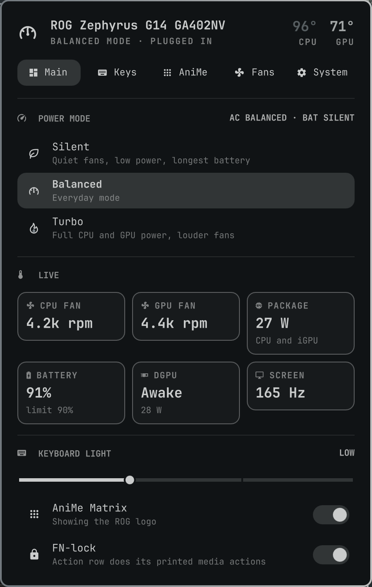

<div align="center">
  
  <h1>ROG Deck</h1>
  <p>An Omarchy bar widget and control panel for <b>ASUS ROG</b> laptops, built on <a href="https://asus-linux.org/">asusctl/asusd</a>:<br/>
  power modes, temperatures and fans, keyboard lighting with auto-off, AniMe Matrix, FN-lock, battery limit, display and GPU mode.</p>
  <p>
    
    
    
    <a href="https://github.com/T3lluz/omarchy-rog-deck/actions/workflows/ci.yml"></a>
    
  </p>
  <p><a href="#install"><b>Install</b></a> · <a href="#features">Features</a> · <a href="#shortcuts-and-ipc">Shortcuts</a> · <a href="#how-it-works">How it works</a></p>
  
</div>

## Features


- **The power mode, animated in the bar:** Silent is a leaf that sways, Balanced a gauge whose needle idles, Turbo a flame that flickers over an ember in your theme's accent. Drawn, not typed, at about 20 frames a second so three monitors stay cheap; turn it off in System.
- **Scroll the icon** to switch modes, middle-click it for the keyboard light, hover it for temperatures, fans and battery.
- **Pick the bar stats:** the mode name, CPU and GPU temperature (tinted as they heat up), fan speed, package power, the NVIDIA GPU's state or draw, battery and refresh rate. None picked leaves the icon alone. The GPU temperature appears only while the dGPU is awake.
- **Every monitor agrees:** one service owns the state, and the bar settings are read straight from `shell.json`, so a pick made on one screen shows on all of them and survives a restart.
- Tabs appear only for hardware your laptop has.

**Main** · Silent, Balanced and Turbo, plus the mode Omarchy keeps for AC and for battery. Live tiles for both fans, package power, battery, the dGPU (read without waking it) and the screen rate. Keyboard light, AniMe and FN-lock.

**Keys** · Brightness. Auto-off after a set time without typing or touchpad use (5 s to 10 min), optionally staying on while plugged in or dimming instead. Light during boot, awake, sleep and shutdown. On RGB keyboards: effect, speed, and a colour that follows the Omarchy theme or one you pick. A white-only keyboard stays on Static: asusd lists animated effects for those too, but they only pulse the white and can get stuck.

**AniMe** · Display on/off, the firmware's Banner or ROG Logo, brightness, startup/sleep/shutdown animations, and off on battery, asleep or with the lid closed.

**Fans** · A curve per power mode, eight points per fan. Drag a bar or type a point's exact °C and %. Presets: Silent (off until about 70 °C), Stock, Cool, Max, plus Reset. A marker shows the live temperature. Curves go into asusd's own per-mode store, so the right one is on the fans whenever the mode changes.

**System** · Charge limit 20–100 with 60/80/100 presets and "Full once". Refresh rate: Auto (highest on AC, 60 Hz on battery) or fixed. Panel overdrive, FN-lock, boot sound. GPU mode: Integrated (NVIDIA off), Hybrid or Dedicated (MUX); a switch only takes hold on restart, so it asks first. What the bar shows, and whether the icon moves.

### In the background

`Service.qml` stays loaded with the panel closed:

- **Keyboard auto-off** uses the same Wayland idle signal as Omarchy's lock screen but ignores "keep awake" inhibitors (a video keeps the screen on, not the keyboard), and keeps its own level so unlocking never leaves the keyboard dark.
- **Mode switching on plug/unplug is Omarchy's.** Omarchy and asusd both switch modes when the charger changes and race; on first run ROG Deck turns asusd's switching off.
- **After login** it puts back FN-lock and the firmware AniMe animations, and moves the Auto refresh rate with the charger.
- **After an Omarchy theme change** it re-applies your keyboard effect, since the theme switcher resets the keyboard to a static colour.

Settings live in `~/.config/rog-deck/settings.json`; what the bar shows lives in the widget's entry in `~/.config/omarchy/shell.json`.

## Install

```bash
omarchy plugin add https://github.com/T3lluz/omarchy-rog-deck.git --enable
```

Needs `asusd` running (Omarchy installs `asusctl` on ROG laptops), `power-profiles-daemon` and `brightnessctl`.

The only root step is Integrated GPU mode, which writes `/etc/supergfxd.conf` the same way Omarchy's own GPU switch does, through `pkexec`. Integrated also needs `supergfxctl`.

FN-lock calls a `fnlock on|off|status` command on your `PATH` (or in `~/.local/bin`). On a G14 that's a small keyd setup: the Fn key never reaches Linux, so keyd swaps the action row and F1–F12 while the lock is on. Without a `fnlock` command the switch is greyed out.

## Shortcuts and IPC

```bash
omarchy-shell io.github.t3lluz.rog-deck cycleProfile    # Silent → Balanced → Turbo → Silent
omarchy-shell io.github.t3lluz.rog-deck nextProfile     # one step up, stops at Turbo
omarchy-shell io.github.t3lluz.rog-deck prevProfile
omarchy-shell io.github.t3lluz.rog-deck profile turbo   # silent | balanced | turbo
omarchy-shell io.github.t3lluz.rog-deck cycleAura       # next keyboard effect
omarchy-shell io.github.t3lluz.rog-deck toggleKeyboard  # keyboard light off / back on
omarchy-shell io.github.t3lluz.rog-deck fnlock toggle   # on | off | toggle
omarchy-shell io.github.t3lluz.rog-deck anime toggle    # on | off | toggle
omarchy-shell io.github.t3lluz.rog-deck toggle          # the panel, on the focused monitor
omarchy-shell io.github.t3lluz.rog-deck openTab fans    # main | lighting | anime | fans | system
omarchy-shell io.github.t3lluz.rog-deck gpu hybrid      # integrated | hybrid | dedicated; asks before restarting
omarchy-shell io.github.t3lluz.rog-deck status          # JSON snapshot
```

The ROG keys, in `~/.config/hypr/bindings.lua`:

```lua
o.bind("XF86Launch1", "ROG Deck", "omarchy-shell io.github.t3lluz.rog-deck toggle")
o.bind("XF86Launch3", "Next keyboard lighting effect", "omarchy-shell io.github.t3lluz.rog-deck cycleAura")
o.bind("XF86Launch4", "Next power mode", "omarchy-shell io.github.t3lluz.rog-deck cycleProfile")
```

## How it works

- `bin/rog-deck` is the backend. `rog-deck status` returns everything as one JSON object in about 0.2 s, read from asusd's D-Bus API, power-profiles-daemon, sysfs and hyprctl. Every change is one `rog-deck` command; `bin/rog-deck --help` lists them.
- `Service.qml` holds the state, the settings file and the background jobs, and owns the IPC target.
- `Panel.qml` and `components/` draw the bar icon and panel; `components/ModeIcon.qml` is the animated mode icon.
- `Model.js` holds the pure logic, tested under node.

Details that matter:

- **Effect changes.** The keyboard can keep animating an old effect while asusd reports the new one, so `rog-deck aura` blanks the keyboard, writes the effect, then re-sends the power state and brightness.
- **Refresh rate.** Hyprland 0.56's Lua config rejects `hyprctl keyword monitor`, so the rate goes through `hyprctl eval "hl.monitor({...})"`. If hyprmoncfg's daemon has an active profile, that profile is saved too, so the change sticks.
- **GPU readings.** `nvidia-smi` is only asked while the dGPU is already awake.
- **GPU modes.** The running mode comes from the hardware: no NVIDIA card (or one parked on vfio-pci) is Integrated, an NVIDIA card driving the eDP panel is Dedicated. asusd queues `gpu_mux_mode` and `dgpu_disable` writes (`QueuedGpuValue`) for its `asus-shutdown` helper, so the mode after restart is read from that queue plus supergfxd's config. The restart is `omarchy-system-reboot`.

## Development

```bash
node tests/model.test.js
bin/rog-deck status | jq
omarchy plugin validate .
omarchy restart shell    # pick up QML changes
```

See [AGENTS.md](AGENTS.md) for how the pieces fit. [docs/PLAN.md](docs/PLAN.md) has the original design notes.

## Credits

- [Power-Deck](https://github.com/T3lluz/Power-Deck), the KDE Plasma original: AniMe, fan curve and keyboard-idle behaviour, the bar-style curve editor.
- [omarchy-asus](https://github.com/moneytosms/omarchy-asus) by moneytosms: hardware-gated tabs, every tab built up front, and the Hyprland 0.56 refresh-rate path.
- [g-helper-linux](https://github.com/utajum/g-helper-linux) and [G-Helper](https://github.com/seerge/g-helper): feature reference.
- [Tabler Icons](https://tabler.io/icons) (MIT): the leaf, gauge and flame outlines the mode icon animates.

## License

MIT. Not affiliated with ASUS or Republic of Gamers.

One of a set of Omarchy plugins: [Batteries](https://github.com/T3lluz/omarchy-batteries) · **ROG Deck** · [Sonus](https://github.com/T3lluz/omarchy-sonus) · [Server Dashboard](https://github.com/T3lluz/omarchy-server-dashboard)
