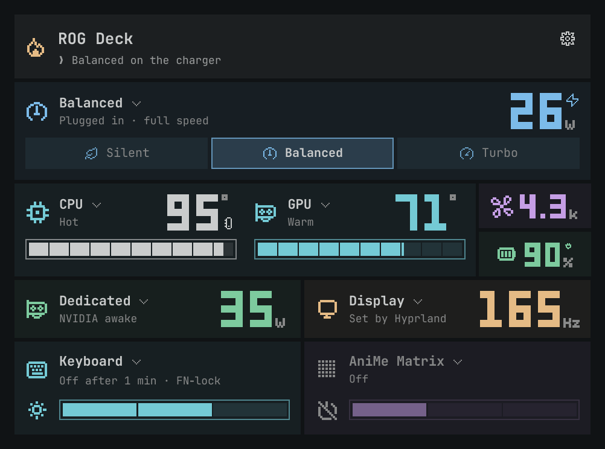

<div align="center">
  
  <h1>ROG Deck</h1>
  <p>An Omarchy bar widget and control panel for <b>ASUS ROG</b> laptops, built on <a href="https://asus-linux.org/">asusctl/asusd</a>:<br/>
  power modes, temperatures and fans, keyboard lighting with auto-off, AniMe Matrix, FN-lock, battery limit and Battery saver, a CPU power limit for Silent, full speed when plugged in, display and GPU mode.</p>
  <p>
    
    
    
    <a href="https://github.com/T3lluz/omarchy-rog-deck/actions/workflows/ci.yml"></a>
    
  </p>
  <p><a href="#install"><b>Install</b></a> · <a href="#features">Features</a> · <a href="#shortcuts-and-ipc">Shortcuts</a> · <a href="#how-it-works">How it works</a></p>
  
</div>

## Features

ROG Deck is one panel of rooms, the look Batteries and Sonus share: each part of the laptop sits in a tile tinted in its own colour from your Omarchy theme, numbers are set big in a block face, and every icon is the same sharp pixel art. Small rooms share a row. Rooms appear only for hardware your laptop has, and a missing one leaves its neighbour the space. A click opens a room to its details; the gear holds the settings.

- **Power** (blue): the mode's icon, its name, the package power as a big figure and the three modes as cells, one click each. Open it for what the running mode adds: in Silent a CPU power limit like G-Helper's, 15 to 35 W on a meter you drag (the boosts rise to the firmware's minimum, so 15 W holds 15 W sustained and boosts to 25 / 35 W); in Balanced, **Full speed when plugged in**, which gives the CPU its performance energy preference on the charger so it clocks up at once instead of ramping. The firmware only honours limits while the mode runs a custom fan curve, so the limit switches Silent's on (asusd's copy of the firmware curve, so the fans behave the same) and switching the limit off puts it back. The open room also says which mode Omarchy keeps for the charger and for battery.
- **CPU and GPU** (cyan, most of a row): each part's temperature in the block face over ten cells, its name over how warm it runs (Cool, Warm from 70 °C, Hot from 85 °C with a mark, so it never rests on colour alone, or Asleep). Open it for both fans and what each part draws. The GPU is read only while it is awake, so checking never wakes it.
- **Fans** (magenta, a small tile beside the CPU and GPU, stacked over the battery): the faster fan's speed (4.3k), with the fan icon turning while the fans spin, faster for faster fans, and still when they stop. Hover it for the curve the running mode uses. Open it for that mode's custom curve, presets (Silent, Stock, Cool, Max, Reset) and the way into the curve editor: eight points per fan per mode, drag a bar or type a point's exact °C and %, with a marker at the live temperature. Curves go into asusd's own per-mode store, so the right one is on the fans whenever the mode changes.
- **Battery** (green, a small tile under the fans, since [Batteries](https://github.com/T3lluz/omarchy-batteries) has the full story): the level, a bolt while it charges and a plug while it holds. Hover it for what the charger is doing; open it for the power flowing in or out, to drag where charging stops (20 to 100%), charge to full once, and turn on Battery saver: on battery, 60 Hz, panel overdrive off, screen power saving and Wi-Fi power save, all put back when the charger returns.
- **Display** (yellow): the refresh rate. Open it to pick Auto (the top rate on the charger, 60 Hz on battery) or a fixed rate, panel overdrive, and screen power saving (amdgpu's panel power savings at level 3 on battery; power-profiles-daemon's own version waits for 50% battery, so Battery saver switches it off and sets the level itself).
- **Graphics** (green): the GPU mode and whether the NVIDIA GPU is awake, asleep or off, with its draw while awake. Open it to switch between Integrated (NVIDIA off), Hybrid and Dedicated (MUX). A switch only takes hold on restart, so it asks first.
- **Keyboard** (cyan): a button that turns the light off and back on, then three cells for Low, Med and High, each one click anywhere in the cell. Open it for auto-off after a set time without typing or touchpad use (15 s to 10 min), staying on while plugged in, dimming instead, and FN-lock.
- **AniMe Matrix** (magenta): the same button and cells for its brightness. Open it to show the firmware's Banner or the ROG logo and to turn it off on battery, asleep or with the lid closed.

**Settings** (the gear, or right-click the bar icon): what the bar shows, when the keyboard is lit (startup, awake, sleep, shutdown), RGB effects and colours, the AniMe Matrix's startup, sleep and shutdown animations, the boot sound, and the version and updates. A white-only keyboard stays on Static: asusd lists animated effects for those too, but they only pulse the white and can get stuck.

- **The bar:** the mode's icon in pixels, the leaf, gauge and speedometer Omarchy's own power menu shows for Silent, Balanced and Turbo; scroll it to switch. Middle-click it for the keyboard light, hover it for a card with every reading. Readings you pick for the bar follow in the same pixel type: the mode name, CPU and GPU temperature (in the urgent colour from 85 °C), fan speed, package power, the NVIDIA GPU's state or draw, battery and refresh rate. Each room has the switches for its own readings; the settings page has them all.
- **Motion:** opening the panel plays one short sequence: the rooms rise in, meters fill while their numbers count up, the lines under each name decode, each icon acts itself out, and the title's prompt types facts about the laptop. Then it holds still, apart from the fan while it runs. Clicks ripple through a room's cells. Omarchy's reduced motion setting stills all of it.
- **Updates itself:** the settings page checks the plugin's GitHub every few hours and updates in place when you click Update. Local edits in the plugin folder, new files included, are kept in `git stash` rather than blocking the update, and dropped when they already are the new version.
- **Banners** above the rooms for what needs you: an error, a GPU switch waiting on a restart, or a new version.
- **Every monitor agrees:** one service owns the state, and the bar settings are read straight from `shell.json`, so a pick made on one screen shows on all of them and survives a restart.

### In the background

`Service.qml` stays loaded with the panel closed:

- **Keyboard auto-off** uses the same Wayland idle signal as Omarchy's lock screen but ignores "keep awake" inhibitors (a video keeps the screen on, not the keyboard), and keeps its own level so unlocking never leaves the keyboard dark.
- **Mode switching on plug/unplug is Omarchy's.** Omarchy and asusd both switch modes when the charger changes and race; on first run ROG Deck turns asusd's switching off.
- **After login** it puts back FN-lock and the firmware AniMe animations, and moves the Auto refresh rate with the charger.
- **On plug and unplug**, about 2 s after Omarchy has switched the mode, it applies Battery saver and the refresh rate, and checks again a few seconds later. Your overdrive choice on the charger is remembered and put back.
- **Silent's CPU limit** is written whenever Silent starts, the charger changes or the laptop wakes, since the firmware loads each mode's own limits then; leaving Silent hands them back to the firmware.
- **After an Omarchy theme change** it re-applies your keyboard effect, since the theme switcher resets the keyboard to a static colour.

Settings live in `~/.config/rog-deck/settings.json`; what the bar shows lives in the widget's entry in `~/.config/omarchy/shell.json`.

## Install

```bash
omarchy plugin add https://github.com/T3lluz/omarchy-rog-deck.git --enable
```

Needs `asusd` running (Omarchy installs `asusctl` on ROG laptops), `power-profiles-daemon` and `brightnessctl`.

Two steps need root, both through `pkexec`. The first is Integrated GPU mode, done the same way Omarchy's own GPU switch does it: the first time, it installs `supergfxctl` from the Omarchy repo, then it writes `/etc/supergfxd.conf`. Integrated is supergfxd's job, not the firmware `dgpu_disable` switch: asusd can only write that switch at shutdown, when the NVIDIA driver still holds the card, so the write fails and the laptop starts in Hybrid.

The second is the power helper, for the CPU limit, screen power saving, Wi-Fi power save and full speed. Turning one on the first time asks for your password once, to install `bin/rog-deck-power` as `/usr/local/libexec/rog-deck-power` (owned by root) and a polkit rule in `/etc/polkit-1/rules.d/49-rog-deck-power.rules` that lets you, at the laptop, run that one program without a password. It only takes CPU limits inside the firmware's range for your laptop and power source (from the kernel's asus-armoury table; GA402NV for now), panel power savings 0–4, Wi-Fi power save on or off, and one of four CPU energy preferences. To remove both: `bin/rog-deck power uninstall`.

FN-lock calls a `fnlock on|off|status` command on your `PATH` (or in `~/.local/bin`). On a G14 that's a small keyd setup: the Fn key never reaches Linux, so keyd swaps the action row and F1–F12 while the lock is on. Without a `fnlock` command the switch is greyed out.

## Shortcuts and IPC

```bash
omarchy-shell io.github.t3lluz.rog-deck cycleProfile    # Silent → Balanced → Turbo → Silent
omarchy-shell io.github.t3lluz.rog-deck nextProfile     # one step up, stops at Turbo
omarchy-shell io.github.t3lluz.rog-deck prevProfile
omarchy-shell io.github.t3lluz.rog-deck profile turbo   # silent | balanced | turbo
omarchy-shell io.github.t3lluz.rog-deck cycleAura       # next keyboard effect
omarchy-shell io.github.t3lluz.rog-deck toggleKeyboard  # keyboard light off / back on
omarchy-shell io.github.t3lluz.rog-deck fnlock toggle   # on | off | toggle
omarchy-shell io.github.t3lluz.rog-deck anime toggle    # on | off | toggle
omarchy-shell io.github.t3lluz.rog-deck saver toggle    # Battery saver: on | off | toggle
omarchy-shell io.github.t3lluz.rog-deck fullSpeed on    # Full speed when plugged in: on | off | toggle
omarchy-shell io.github.t3lluz.rog-deck toggle          # the panel, on the focused monitor
omarchy-shell io.github.t3lluz.rog-deck openTab fans    # a room: power | battery | fans | display | graphics | keyboard | anime
                                                        # or settings | curve (the fan curves)
omarchy-shell io.github.t3lluz.rog-deck gpu hybrid      # integrated | hybrid | dedicated; asks before restarting
omarchy-shell io.github.t3lluz.rog-deck status          # JSON snapshot
omarchy-shell io.github.t3lluz.rog-deck version         # installed version
omarchy-shell io.github.t3lluz.rog-deck checkUpdates    # look for a newer version now
omarchy-shell io.github.t3lluz.rog-deck update          # install it, if one was found
```

The ROG keys, in `~/.config/hypr/bindings.lua`:

```lua
o.bind("XF86Launch1", "ROG Deck", "omarchy-shell io.github.t3lluz.rog-deck toggle")
o.bind("XF86Launch3", "Next keyboard lighting effect", "omarchy-shell io.github.t3lluz.rog-deck cycleAura")
o.bind("XF86Launch4", "Next power mode", "omarchy-shell io.github.t3lluz.rog-deck cycleProfile")
```

## How it works

- `bin/rog-deck` is the backend. `rog-deck status` returns everything as one JSON object in about 0.2 s, read from asusd's D-Bus API, power-profiles-daemon, sysfs and hyprctl. Every change is one `rog-deck` command; `bin/rog-deck --help` lists them.
- `Service.qml` holds the state, the settings file and the background jobs, and owns the IPC target.
- `Panel.qml` and `components/` draw the bar icon, the hover card and the panel: a file per room, the Rooms pieces shared with Batteries and Sonus, and the panel kit shared by all four plugins in this family.
- `Model.js` holds the pure logic and `components/Rooms.js` the look's (tones, the block face, the pixel type, meters, motion), both tested under node.
- The icons are [Pixelarticons](https://pixelarticons.com) (MIT), plus a fan and the AniMe Matrix drawn on the same grid, built into `components/Pixels.js` by `scripts/fetch-pixel-icons.py`.

Details that matter:

- **Effect changes.** The keyboard can keep animating an old effect while asusd reports the new one, so `rog-deck aura` blanks the keyboard, writes the effect, then re-sends the power state and brightness.
- **Refresh rate.** Hyprland 0.56's Lua config rejects `hyprctl keyword monitor`, so the rate goes through `hyprctl eval "hl.monitor({...})"`, naming the panel by its description because a rule for the connector name would inherit `disabled` from a leftover Omarchy clamshell flag. hyprmoncfg's daemon puts the screens back the way its best-matching profile has them after any change, so the new rate is saved into the active profile. With the laptop off its desk no profile is active and the daemon falls back to the desk profile and its rate; ROG Deck then keeps a "Laptop" profile with just the built-in screen, which the daemon matches exactly. A profile with only some of a desk's screens isn't made for you: save that layout once in hyprmoncfg and the rate sticks there too.
- **CPU limits.** The same three ASUS ACPI limits G-Helper sets on this laptop (sustained `0x1200A3`, slow boost `0x1200A0`, fast boost `0x1200C1`), through the kernel's asus-nb-wmi attributes. The firmware doesn't report them back, so the panel shows what was last written. On a GA402NV on battery, a full-load test with 15 W held about 15–25 W at 75 °C; without the custom fan curve the same writes did nothing (33 W, 95 °C).
- **Full speed.** power-profiles-daemon gives Balanced `balance_performance` on the charger, which leaves the firmware to ramp the clock, and it can miss a plug-in and leave the battery's `balance_power` in place. Full speed writes `performance` to every core's `energy_performance_preference` and leaves the governor and the mode's fans and power limits alone, so Balanced stays Balanced. Turbo needs nothing: its performance governor already holds the preference there. The daemon writes its own value again on every mode and charger change, so ROG Deck applies after those settle. `rog-deck speed off` puts the daemon's value for the mode back, and only if `speed on` set the one in place. It is on by default but needs the power helper: until that is installed it does nothing and its switch shows off, and a click on the switch installs it.
- **GPU readings.** `nvidia-smi` is only asked while the dGPU is already awake.
- **GPU modes.** The running mode comes from the hardware: no NVIDIA card (or one parked on vfio-pci) is Integrated, an NVIDIA card driving the eDP panel is Dedicated. asusd queues `gpu_mux_mode` writes (`QueuedGpuValue`) for its `asus-shutdown` helper, so the mode after restart is read from that queue plus supergfxd's config. A queued `dgpu_disable=1` from an earlier version is cancelled. The restart is `omarchy-system-reboot`.
- **Updates.** `bin/plugin-update check` (or `rog-deck update check`) fetches the plugin's remote (only `.git` changes, which the shell ignores) and compares versions; `apply` runs detached, stashes local edits with untracked files, and calls `omarchy plugin update`, which fast-forwards, validates and reloads the plugins. The result lands in `~/.local/state/rog-deck/update.json` for the reloaded panel.

## Development

```bash
node tests/model.test.js
node tests/rooms.test.js
node tests/update.test.js
python3 -B -m unittest discover tests
python3 scripts/fetch-pixel-icons.py --show   # every icon's grids
bin/rog-deck status | jq
omarchy plugin validate .
omarchy restart shell    # pick up QML changes
```

See [AGENTS.md](AGENTS.md) for how the pieces fit. [docs/PLAN.md](docs/PLAN.md) has the original design notes.

## Credits

- [Power-Deck](https://github.com/T3lluz/Power-Deck), the KDE Plasma original: AniMe, fan curve and keyboard-idle behaviour, the bar-style curve editor.
- [omarchy-asus](https://github.com/moneytosms/omarchy-asus) by moneytosms: hardware-gated tabs, every tab built up front, and the Hyprland 0.56 refresh-rate path.
- [g-helper-linux](https://github.com/utajum/g-helper-linux) and [G-Helper](https://github.com/seerge/g-helper): feature reference, and the evidence that Eco/Integrated has to happen before the display stack holds the dGPU.

## License

MIT. Not affiliated with ASUS or Republic of Gamers.

One of a set of Omarchy plugins: [Batteries](https://github.com/T3lluz/omarchy-batteries) · **ROG Deck** · [Sonus](https://github.com/T3lluz/omarchy-sonus) · [Server Dashboard](https://github.com/T3lluz/omarchy-server-dashboard)
